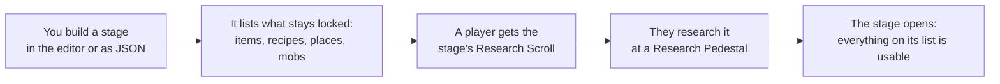

# History Stages

History Stages is a progression and gatekeeping framework for modpack authors. You define
**stages**, you list what each stage holds back, and players unlock them by researching at a
pedestal. Until a stage opens, everything listed in it is out of reach — the item cannot be used,
the recipe cannot be crafted, the dimension cannot be entered, the mob does not spawn.

Nothing is locked out of the box. An installed History Stages with no stage files changes nothing
about the game.

Which version is this?

These pages describe **6.2.x**, the line every loader is on, the 26.2 beta included. An older
build? Pick it in the version picker in the top bar.
[Versions & Platforms](/wiki/about/versions-and-platforms) has the details.

## How it fits together

Research is the usual way in, not the only one: a stage can also open by itself when a condition is
met, or by command. → [Stage Modes](/wiki/stage-file/stage-modes) ·
[Research Pedestal](/wiki/in-game-tools/research/pedestal) ·
[Research Scrolls](/wiki/in-game-tools/research/scrolls)

## Two kinds of stage

|  | Unlocked by | Applies to | Typical use |
| :--- | :--- | :--- | :--- |
| **Global** | one player, once | the whole server | eras — Stone Age, Iron Age, Endgame |
| **Individual** | every player, separately | that player only | personal skill paths, professions |

They mix freely in the same pack, and a few lock types only work in one of them. When the same
content is listed in a global *and* an individual stage, History Stages turns on a two-step
**dual-phase lock** for it by itself.

→ [Global vs Individual Stages](/wiki/start-here/global-vs-individual) is the page to read before
designing a pack. It carries the full matrix of which lock works in which mode, and why.

## What a stage can hold back

| | |
| :--- | :--- |
| [Items, Tags & Mods](/wiki/locking/items-and-recipes/items-tags-mods) | Single items, whole item tags, or every item from a mod id. |
| [NBT & Data Components](/wiki/locking/items-and-recipes/nbt-and-components) | Only the enchanted books with Sharpness, only the red leather chestplate. |
| [Unlock Actions](/wiki/locking/items-and-recipes/unlock-actions) | Gate one interaction instead of all of them — carry it but do not swing it. |
| [Recipes](/wiki/locking/items-and-recipes/recipes) | Specific recipe ids, with a lock overlay in JEI and EMI. |
| [Fluids](/wiki/locking/items-and-recipes/fluids) | The fluid, not the bucket — one entry covers every tank and bucket in the pack. |
| [Enchantments & Effects](/wiki/locking/items-and-recipes/enchantments-and-effects) | Books, gear and potions by what they carry, and the stations that make them. |
| [Disguises](/wiki/locking/items-and-recipes/disguises) | A locked item or block that looks like something else until it opens. |
| [Loot](/wiki/locking/items-and-recipes/loot) | Remove or replace locked items in chest loot and mob drops. |
| [Slots](/wiki/locking/items-and-recipes/slots) | Inventory and container slots that stay shut until the stage opens. |
| [Dimensions & Structures](/wiki/locking/world/dimensions-and-structures) | Refuse entry to a dimension, wall off a structure, or cap how often it generates. |
| [Biomes](/wiki/locking/world/biomes) | Make a biome unsurvivable until the stage opens. |
| [Plants](/wiki/locking/world/plants) | Crops and saplings that do not grow until the stage opens. |
| [Zones](/wiki/locking/world/zones) | Areas you draw yourself, each with its own rules. |
| [Entities & Spawns](/wiki/locking/creatures-and-trade/entities-and-spawns) | Stop attacks, stop breeding and mounting, or write a full spawn rule. |
| [Merchant Trades](/wiki/locking/creatures-and-trade/merchant-trades) | Gate one offer, a whole villager profession, or a merchant level everywhere. |

→ [What You Can Lock](/wiki/locking) has the same list sorted by kind, and what to know before
picking one.

## Build it in the game

The [In-Game Editor](/wiki/in-game-tools/in-game-editor) is the normal way to build a pack, and
almost every pack is built entirely in it. Pause menu, permission level 2, or `/history editor`.

A stage opens with one tab per thing it can lock, plus searchable pickers that read the live
registry, a visual NBT editor, a zone editor with a map, and a dependency editor. You cannot write
an id that does not exist, and a save reloads immediately.

**The files underneath are plain JSON**, one per stage, under `config/historystages/`. They are
readable and editable by hand, and the editor writes the same format — so the two mix freely. This
wiki describes stages by their fields rather than by which button to press, because a field is
easier to name; each page says where in the editor the same thing lives.

→ [Installation & Your First Stage](/wiki/start-here/installation) ·
[Where Stage Files Live](/wiki/start-here/where-stage-files-live) ·
[Anatomy of a Stage File](/wiki/stage-file/anatomy)

Setting up a multiplayer server for the first time? →
[Putting It on a Server](/wiki/start-here/server-setup) walks through it step by step. Something
behaves oddly? → [Troubleshooting](/wiki/start-here/troubleshooting)

## Showing players where they are

Large packs can open an interactive [Stage Graph](/wiki/in-game-tools/stage-graph) from the pause
menu, drawing the whole progression tree with the player's own position in it.

Scripts read and change stage state through [KubeJS and CraftTweaker](/wiki/server/scripting), and
other mods extend History Stages through the [Addon API](/api/addon-development).
