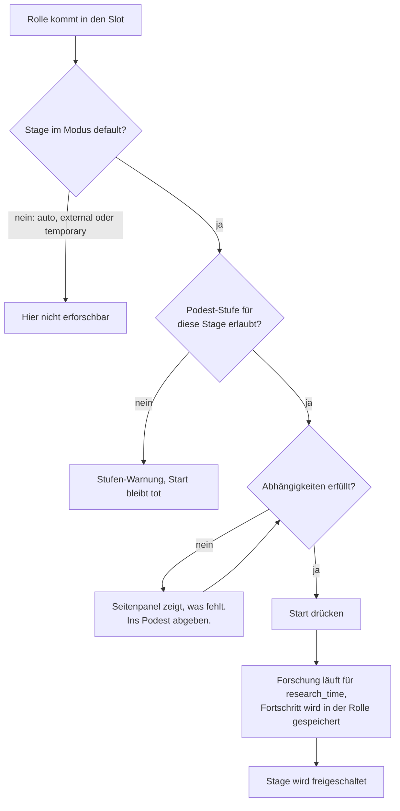

# Forschungspodest {/* #research-pedestal */}

Am Podest passiert der Fortschritt tatsächlich. Ein Spieler legt eine
[Forschungsrolle](/wiki/in-game-tools/research/scrolls) hinein, die Forschung läuft für die
`research_time` der Stage, und wenn sie fertig ist, wird die Stage freigeschaltet.


Während die Forschung läuft, leuchtet das Podest (Lichtstufe 13) und zeigt den Fortschritt in seiner
GUI. **Der Fortschritt wird in der Rolle selbst gespeichert**, nicht im Block. Ein Spieler kann die
Rolle also herausnehmen, weggehen und später weitermachen, oder sie an einem ganz anderen Podest
beenden.



## Starten und pausieren {/* #starting-and-pausing */}

Die Forschung beginnt nicht von selbst. Eine Rolle, die in einem Podest liegt und bei der alles passt,
wartet trotzdem auf den Knopf **Start**; während ein Durchlauf läuft, heißt derselbe Knopf **Pause**,
und Pausieren ist immer erlaubt.

Durch eine Pause, eine Unterbrechung oder eine nicht erfüllte Bedingung geht nichts verloren. Der
Fortschritt bleibt, und der Durchlauf geht einfach nicht weiter. Genau das passiert auch, wenn eine
Abhängigkeit mittendrin nicht mehr erfüllt ist oder die Rolle in ein Podest der falschen Stufe kommt.

## Abhängigkeiten abgeben {/* #handing-in-dependencies */}

Hat eine Stage [Abhängigkeiten](/wiki/stage-file/dependencies), erweitert sich die GUI des Podests um
ein Seitenpanel, das jede Bedingung auflistet und ob sie erfüllt ist. Bedingungen, die man abgibt, also
Items, Item-Tags und XP-Level, werden erfüllt, indem man sie direkt ins Podest legt, bei Bedarf auch
nach und nach. Der Zähler an jedem Eintrag zeigt, wie weit er ist. Items von Hand abzugeben rechnet die
Kosten-Senkung des Boosters genauso ein wie der Abgabe-Slot.

Eine Stage kann außerdem durch ihre Logik [blockiert](/wiki/stage-file/logic-blocks#blocked-while)
sein oder [günstiger oder teurer](/wiki/stage-file/logic-blocks#cheapercostlier-while), solange eine
andere Stage freigeschaltet ist. Das Podest zeigt einen roten Kasten mit dem Grund und lässt den
Start-Knopf deaktiviert, solange eine Stage blockiert ist, und eine Zeile, was günstiger ist und warum,
solange ein Kosten-Baustein gilt.

## Stufen {/* #tiers */}

Es gibt vier Podeste, damit ein Modpack späte Forschung hinter einen aufwendigeren Aufbau legen kann:

| Stufe | Block-ID | |
| :--- | :--- | :--- |
| I | `historystages:research_pedestal` | Einzelner Block. |
| II | `historystages:research_pedestal_tier_2` | Einzelner Block. |
| III | `historystages:research_pedestal_tier_3` | Breiter, aus mehreren Blöcken. |
| IV | `historystages:research_pedestal_tier_4` | Das größte. |

Jede Stufe ist ein eigener Block. Für eine höhere Stufe musst du keine niedrigere abbauen; es sind
getrennte Blöcke, und das Podest, in dem eine Rolle liegt, entscheidet sowohl über die Stufen-Sperre als
auch darüber, welche [Booster](#boosters) zählen.

### Podest-Stufe pro Stage {/* #tier-gating-per-stage */}

Zwei optionale Felder in der Stage-Datei schränken ein, wo sie erforscht werden darf:

| Feld | Typ | Standard | |
| :--- | :--- | :--- | :--- |
| `min_pedestal_tier` | Integer 1–4 | `1` | Die niedrigste Stufe, die diese Stage erforschen darf. |
| `pedestal_tier_mode` | String | `"min"` | `"min"`: diese Stufe und höher. `"exact"`: nur diese Stufe. |

Eine Rolle in einem Podest, das nicht passt, bekommt in der GUI eine Warnung zur Stufe, und die
Forschung startet einfach nicht.

Ob Spieler die Anforderung sehen, bevor sie es versuchen, regelt `showScrollTierTooltip` in
[`[visuals]`](/wiki/server/config-files/visual-toml#visuals), standardmäßig an.

## Booster {/* #boosters */}

Ein Booster ist ein normaler Block, der **direkt unter** einem aktiven Podest steht. Er verändert die
Forschung darüber auf zwei Arten:

- **Tempo-Senkung** verkürzt die Forschungszeit. Höchstens 90 %, also läuft die Forschung höchstens
  10-mal schneller.
- **Kosten-Senkung** senkt die Anzahl bei Item-Abhängigkeiten. Sie wird **bei der ersten Abgabe in der
  Rolle festgeschrieben**, damit man sie nicht austricksen kann, indem man mittendrin Booster tauscht.

Booster werden in [`researchBoosters`](/wiki/server/config-files/gameplay-toml#research) angegeben,
ein kommagetrennter String pro Eintrag:

```text
"block_id, speed_percent, cost_percent, tier, mode"
```

| Teil | Werte |
| :--- | :--- |
| `speed_percent` / `cost_percent` | 0–90. |
| `tier` | Die niedrigste Podest-Stufe, unter der der Booster wirkt, 1–4. |
| `mode` | `min` (diese Stufe und höher) oder `exact` (nur diese Stufe). |

```toml
researchBoosters = [
    "minecraft:redstone_block, 25, 0, 1, min",
    "minecraft:diamond_block, 50, 25, 2, min",
    "minecraft:beacon, 75, 50, 4, exact"
]
```

Die Liste lässt sich auch im Spiel über den [Config-Editor](/wiki/in-game-tools/in-game-editor)
bearbeiten, also kannst du Booster-Blöcke und ihre Stufen einrichten, ohne die Datei anzufassen.

### Welcher Block geprüft wird {/* #which-block-gets-checked */}

Podeste der Stufe I und II prüfen **den einzelnen Block direkt darunter**.

Stufe III und IV bestehen aus mehreren Blöcken, also prüft die Mod **beide** Positionen darunter, den
Fuß-Block und den Kopf-Block, und wendet nur den **stärksten** Treffer an. Tempo-Senkung gewinnt;
Kosten-Senkung entscheidet bei Gleichstand; bei völligem Gleichstand gewinnt der Fuß-Block. Ein Booster,
dessen `tier` / `mode` nicht zum Podest darüber passt, wird ganz ignoriert statt teilweise angewendet.

Booster sind als eigene Rezept-Kategorie in JEI/EMI angemeldet, damit Spieler nachschauen können, welche
Blöcke helfen und wie viel. Der Hover-Text am Block selbst ist `showBoosterTooltips` in
[`[visuals]`](/wiki/server/config-files/visual-toml#visuals).

## Komparator-Signal {/* #comparator-output */}

Das Podest treibt einen Komparator an, also kann Redstone auf die Forschung reagieren:

| Signal | Bedeutung |
| :--- | :--- |
| `0` | Keine Rolle, oder die Forschung hat nicht begonnen. |
| `1`–`14` | Läuft, steigt gleichmäßig. |
| `15` | Fertig. |

Das Signal springt auf `1`, sobald die Forschung beginnt, und steigt dann gleichmäßig bis `15`. Das
reicht, um eine Fortschrittsanzeige zu betreiben, einen Sound auszulösen oder eine Tür geschlossen zu
halten, bis die Forschung fertig ist.

Bei Podesten der Stufe III und IV geben Fuß-Block und Kopf-Block dasselbe Signal aus.

## Podeste ins Modpack bringen {/* #getting-pedestals-into-the-pack */}

Standardmäßig gibt es keine Rezepte für die Podeste. →
[Rollen & Podeste beschaffen](/wiki/in-game-tools/research/obtaining)

## Siehe auch {/* #see-also */}

- [Forschungsrollen](/wiki/in-game-tools/research/scrolls): das Item, das ins Podest kommt.
- [Abhängigkeiten](/wiki/stage-file/dependencies): was das Seitenpanel auflistet.
- [Stage-Modi](/wiki/stage-file/stage-modes): die Modi, die das Podest ganz überspringen.
