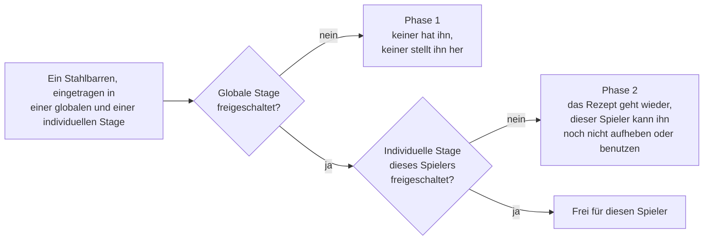

# Globale vs. individuelle Stages {/* #global-vs-individual-stages */}

History Stages kennt zwei Fortschrittsmodelle: **Global** (für den ganzen Server) und **Individuell**
(pro Spieler). Beide können im selben Modpack nebeneinander laufen, aber sie sperren unterschiedliche
Dinge und verhalten sich für Spieler anders. Welche Art eine Stage ist, hängt nur davon ab,
[in welchem Ordner ihre Datei liegt](/wiki/start-here/where-stage-files-live).

## Was kann welche Art sperren? {/* #what-can-each-one-lock */}

Nicht jede Sperr-Art funktioniert in beiden Modi. Erwischst du die falsche Stage-Art, wird deine Sperre
stillschweigend ignoriert. Sehen kannst du das nur in `debug-*.log`.

| Sperr-Art | Global | Individuell |
|---|:---:|:---:|
| [Items / Blöcke](/wiki/locking/items-and-recipes/items-tags-mods) (use, attack, equip, pickup, place, break, gui) | ja | ja |
| [Tags](/wiki/locking/items-and-recipes/items-tags-mods#tags) | ja | ja |
| [Mods](/wiki/locking/items-and-recipes/items-tags-mods#mods) (inkl. `mod_exceptions`) | ja | ja |
| [NBT-Items](/wiki/locking/items-and-recipes/nbt-and-components) | ja | ja |
| [Flüssigkeiten](/wiki/locking/items-and-recipes/fluids) (was ein Eimer oder Tank enthält) | ja | ja |
| [Rezepte](/wiki/locking/items-and-recipes/recipes) | ja | ja, an Stationen mit Spieler |
| [Loot-Tables](/wiki/locking/items-and-recipes/loot) (ersetzen/entfernen in Truhen und Drops) | ja | ja |
| [Dimensionen](/wiki/locking/world/dimensions-and-structures) | ja | ja |
| [Strukturen](/wiki/locking/world/dimensions-and-structures) | ja | ja |
| [Grenzen für Struktur-Generierung](/wiki/locking/world/dimensions-and-structures#generation-limits) (`block_generation`) | ja | **nein** |
| [Biome](/wiki/locking/world/biomes) | ja | ja |
| [Pflanzen](/wiki/locking/world/plants) (Feldfrüchte und Setzlinge wachsen nicht) | ja | **nein** |
| [Zonen](/wiki/locking/world/zones) (selbst gezeichnete Bereiche) | ja | ja, außer „keine Mob-Spawns“ |
| [`attacklock`](/wiki/locking/creatures-and-trade/entities-and-spawns#attacklock) (Spieler kann den Mob nicht angreifen) | ja | ja |
| [`interactionlock`](/wiki/locking/creatures-and-trade/entities-and-spawns#interactionlock) (züchten/reiten/handeln/anleinen/…) | ja | ja |
| [`spawnlock`](/wiki/locking/creatures-and-trade/entities-and-spawns#spawnlock) (Mob spawnt überhaupt nicht) | ja | **nein** |
| [Händler-Angebote](/wiki/locking/creatures-and-trade/merchant-trades) (`trades` → `offers`) | ja | ja |
| [Händler-Berufe und -Stufen](/wiki/locking/creatures-and-trade/merchant-trades) | ja | ja |
| [Verzauberungen](/wiki/locking/items-and-recipes/enchantments-and-effects) | ja | ja |
| [Trank-Effekte](/wiki/locking/items-and-recipes/enchantments-and-effects) | ja | ja, außer am Braustand |
| [Slots](/wiki/locking/items-and-recipes/slots) im Inventar des Spielers | ja | ja |
| [Slots](/wiki/locking/items-and-recipes/slots) von Behältern | ja | **nein** |
| [`lose_on_death`](#lose-on-death) | **nein** | ja |
| [`share_with_team`](#sharing-with-a-team) | **nein** | ja |
| [While-Modus](/wiki/stage-file/relocking#the-while-mode) | nur Welt-Zustände | ja |

**Warum manche nur auf einer Seite gehen.** `spawnlock` ist eine Mechanik für die ganze Welt: Ein
Mob-Spawn weiß nicht, für wen er erscheint, und eine individuelle Sperre braucht einen konkreten
Spieler („dieser Spieler wollte gerade dieses Item benutzen“). Der Schalter **keine Mob-Spawns** einer
Zone ist dieselbe Frage an anderer Stelle und deshalb ebenfalls nur global. Alles andere, was eine Zone
tut, hat einen Spieler, der darin steht, und funktioniert in beiden. Bei `block_generation` ist es
derselbe Grund: Die Weltgenerierung passiert einmal, dauerhaft und für die ganze Welt, es gibt also
keinen Chunk pro Spieler, den man sperren könnte. Pflanzen wachsen in zufälligen Ticks ohne
zugehörigen Spieler, und zwei Spieler, die in dieselbe Truhe schauen, können nicht unterschiedliche
Slots sehen. Darum sind Pflanzen-Sperren und Behälter-Slots ebenfalls nur global. `lose_on_death` ist
der umgekehrte Fall: Es gibt keinen einzelnen Spieler, dessen Tod eine Stage wieder sperren sollte, die
der ganze Server teilt.

Flüssigkeiten funktionieren in beiden, weil nach einer Flüssigkeit immer nur gefragt wird, wenn ein
Spieler dabei ist. Die eine Stelle, an der das nicht klappt, ist die Rezept-Seite einer
Flüssigkeits-Sperre in einer individuellen Stage: Sie erreicht nur die Stationen, die wissen, wer
gerade herstellt, genau wie bei `recipes`.

## Wie Spieler es erleben {/* #how-the-player-experiences-it */}

### Global und individuell sperren auf unterschiedlichen Ebenen {/* #global-and-individual-lock-at-different-layers */}

Hier stolpern die meisten. Dasselbe Item in einer globalen und in einer individuellen Stage
aufzulisten, bewirkt sehr Unterschiedliches.

**Globale Stage: Das Rezept verschwindet.**

Solange die Stage gesperrt ist, wird jedes Rezept, dessen Ergebnis das gesperrte Item ist, aus dem
`RecipeManager` herausgefiltert. Das gilt für jede Rezeptart, die das Spiel kennt:

- Werkbank und Crafter
- Ofen, Räucherofen, Schmelzofen, Lagerfeuer
- Steinsäge, Schmiedetisch
- Braustand
- Eigene Rezeptarten aus KubeJS, CraftTweaker und anderen Mods

Das Item lässt sich nicht herstellen. Niemand auf dem Server kann es craften. JEI und EMI zeigen ein
Schloss-Overlay oder blenden das Rezept ganz aus, wenn `hideLockedItemsInJei` oder
`hideLockedRecipesInJei` an ist. Das Feld `recipes` ist darüber hinaus ein feineres Werkzeug: Es
entfernt bestimmte Rezept-IDs von Hand, wenn nur eine von mehreren Varianten weg soll.

Eine Ausnahme: Ein Item-Eintrag kann `recipe` aus der Sperre herausnehmen. `unlock_actions` listet die
Aktionen, die **frei** bleiben, also hält `"unlock_actions": ["recipe"]` das Rezept herstellbar,
während alles andere am Item gesperrt bleibt. → [Unlock Actions](/wiki/locking/items-and-recipes/unlock-actions).

**Individuelle Stage: Das Item weigert sich, im Inventar zu landen.**

Das Rezept bleibt in der Registry. Jeder Spieler, der die Stage hat, kann es ganz normal herstellen.
Für einen gesperrten Spieler greifen mehrere Mechaniken ineinander, damit das Item nie wirklich in
seinem Inventar landet:

- Aufheben vom Boden wird blockiert.
- Ein Klick darauf in irgendeinem Slot irgendeines Behälters, ob Truhe, Ergebnis-Slot der Werkbank oder
  sonst wo, wird abgebrochen, sobald der gesperrte Spieler danach greift.
- Beim Einloggen durchsucht der Server das Inventar des Spielers und wirft jeden Stack heraus, dessen
  `pickup`-Aktion für ihn inzwischen gesperrt ist. So fängt das System Items ab, die gesperrt wurden,
  während der Spieler offline war.
- Die normalen Aktions-Sperren (use, equip, place, …) gelten weiterhin, falls das Item trotzdem in
  seiner Hand landet, zum Beispiel per `/give` von einem Operator.

Das Rezept gibt es also noch, aber ein gesperrter Spieler kann das Item nicht haben. Ein Spieler mit
der Stage kann an derselben Werkbank stehen und es herstellen, ohne dass ihn etwas aufhält. Nur der
gesperrte Spieler bleibt außen vor.

Die Aufheben-Sperre lässt sich mit `lockItemPickup` in `[individual_stages]` abschalten (standardmäßig
an). Die Sperre für Klicks in Behältern ist ein eigener Schalter, `lockContainerInteraction`. →
[gameplay.toml](/wiki/server/config-files/gameplay-toml#individual_stages).

### Rezept-Sperren pro Spieler, und wo sie aufhören {/* #per-player-recipe-locks-and-where-they-stop */}

Seit 6.0 funktioniert das Feld `recipes` auch in einer individuellen Stage, ebenso ein Item-Eintrag,
dessen `recipe`-Aktion gesperrt ist. Beide werden pro Spieler an den Stationen gesperrt, die wissen,
wer davor steht:

- Werkbank
- Das 2×2-Raster im eigenen Inventar
- Steinsäge
- Schmiedetisch

An diesen vier macht eine individuelle Stage genau das, was eine globale macht: Der Ergebnis-Slot bleibt
leer, und bei der Steinsäge wird das gesperrte Rezept gar nicht erst als Knopf angeboten. Zwei Spieler
können an derselben Werkbank stehen und unterschiedliche Ergebnisse bekommen.

**Überall sonst bleibt es nur global**, weil es keinen Spieler gibt, den man fragen könnte:

- Ofen, Schmelzofen, Räucherofen, Lagerfeuer
- Braustand
- Der Crafter-Block, Trichter-Zufuhr und Autocrafter aus Mods
- Jede Mod-Station mit eigenem Menü, deren Rezeptart nicht als „pro Spieler sperrbar“ angemeldet ist

**Eine andere Mod kann die Liste erweitern.** Seit 6.0.0 darf eine Mod eine ihrer eigenen Rezeptarten
als pro Spieler sperrbar anmelden, und der Editor bietet sie dann an wie die drei eingebauten. Das ist
ein Versprechen über die eigene Station der Mod, nämlich dass ein Spieler davor steht und unsere Hooks
ihn sehen. Die Liste oben ist also das Minimum aus Vanilla, nicht alles. →
[Addon-Entwicklung](/api/addon-development).

:::warning
**Ein Rezept, das eine individuelle Stage sperrt, lässt sich in einem Autocrafter trotzdem
herstellen.** Für Fortschritts-Design, etwa ein Berufe-System oder einen Forschungsbaum, ist das in
Ordnung, aber es ist kein Schutz gegen Schummeln. Wenn etwas wirklich unerreichbar sein muss, nimm
eine globale Stage.
:::

Amboss, Webstuhl und Kartentisch fehlen in beiden Listen: Sie arbeiten gar nicht mit Rezepten. Vanilla
hat genau sieben Rezeptarten, und diese drei Stationen benutzen keine davon. Es gibt also keine
Rezept-ID, die man in eine Stage schreiben könnte.

Der Schalter für all das ist `lockRecipes` in `[individual_stages]`, standardmäßig an. →
[Rezepte](/wiki/locking/items-and-recipes/recipes) zeigt das ganze Bild.

### Mob-Spawns (nur global) {/* #mob-spawns-global-only */}

`entities.spawnlock` verhindert, dass ein Mob überhaupt in der Welt erscheint. Das ist eine
Entscheidung für die ganze Welt, pro Spieler ergibt sie keinen Sinn. Es gibt sie nur in globalen
Stages.

`attacklock` ist die Variante, die mit individuellen Stages funktioniert. Der Mob spawnt normal, und
Spieler mit der Stage können ihn angreifen, aber für einen gesperrten Spieler wird jeder Angriff
abgebrochen.

### Items, Blöcke, Dimensionen, Strukturen {/* #items-blocks-dimensions-structures */}

Die Sperre funktioniert in beiden Modi gleich. Was sich ändert, ist, für wen sie gilt.

- **Global:** Einmal freigeschaltet, ist der Inhalt für jeden Spieler auf dem Server frei. Neue
  Spieler kommen direkt in den freigeschalteten Zustand.
- **Individuell:** Jeder Spieler muss die Stage selbst freischalten. Neue Spieler fangen bei null an,
  egal was andere schon geschafft haben.

Darum kann Spieler A schon durchs End laufen, während Spieler B sich noch durch die Steinzeit kämpft.
Bei individuellen Stages normal, bei globalen unmöglich.

### Welche Abhängigkeiten welche Art nutzen kann {/* #which-dependencies-each-one-can-use */}

Eine Stage kann Bedingungen verlangen, bevor sie erforscht werden darf, und welche Arten es gibt, hängt
von der Stage-Art ab. Die Aufteilung ist nicht willkürlich: Eine Bedingung pro Spieler braucht einen
klar bestimmten Forscher. Eine individuelle Forschungsrolle hat ab dem Start der Forschung einen festen
Besitzer. Eine globale Rolle hat keinen.

**Beide Stage-Arten** können Items und Item-Tags am Podest verlangen, eine andere globale Stage, eine
individuelle Stage, die gemeinsam gehalten wird, und ein Scoreboard-Ziel.

**Individuelle Stages** kommen mit vier weiteren, die einen bestimmten Spieler brauchen: Fortschritte
(Advancements), XP-Level, Anzahl getöteter Kreaturen und erfasste Statistiken. Schreibt man sie von Hand
in eine globale Stage, werden sie nicht entfernt. Die Prüfung überspringt sie einfach, statt sie an dem
zu messen, der das Podest zuletzt geöffnet hat.

→ [Abhängigkeiten](/wiki/stage-file/dependencies) zeigt jede Bedingung, die UND/ODER-Regeln und die
`individual_stages`-Modi.

## Bei Tod verlieren {/* #lose-on-death */}


Eine individuelle Stage kann sich selbst wieder sperren, wenn ihr Besitzer stirbt:

```json
{ "lose_on_death": true }
```

Globale Stages können das nicht nutzen, denn es gibt keinen einzelnen Spieler, dessen Tod eine Stage
sperren sollte, die der ganze Server teilt. Ist es aus, wird das Feld ganz weggelassen statt als
`false` geschrieben.

Die Sperre passiert **beim Tod selbst, nicht beim Respawn**. Die frisch wieder gesperrten Items der
Stage landen also in den Drops des Spielers. Zusammen mit `keepInventory` sind dann genau bestimmte
Fortschritts-Items das Einzige, was ein Spieler beim Tod verlieren kann.

Läuft die Stage im Modus [`temporary`](/wiki/stage-file/stage-modes#temporary) mit laufendem Timer,
beendet der Tod diesen Timer vorzeitig und startet die Abklingzeit, als wäre er normal abgelaufen. Für
`max_triggers` zählt das genauso wie ein normales Ablaufen.

## Mit einem Team teilen {/* #sharing-with-a-team */}

:::info[Neu in 6.1.0]
Noch nicht auf 26.2: FTB Teams gibt es nicht für 26.2, daher hat die 26.2-Beta kein Teilen im Team.
:::

Eine individuelle Stage lässt sich innerhalb einer FTB-Teams-Party teilen:

```json
{ "share_with_team": true }
```

Schaltet ein Spieler der Party die Stage frei, bekommen sie alle anderen in der Party auch.
Teammitglieder, die offline sind, bekommen sie beim nächsten Einloggen.

- Nur echte Partys zählen. Das eigene Solo-Team eines Spielers teilt nie etwas.
- Ein Teammitglied, für das die Stage [endgültig verloren](/wiki/stage-file/relocking#lost-for-good)
  oder [blockiert](/wiki/stage-file/logic-blocks#blocked-while) ist, bekommt sie nicht.
- `temporary`- und `conditional`-Stages werden nie geteilt. Ihr Timer oder ihre Bedingung gehört zu
  einem Spieler; geteilt würde die Stage zwischen Teammitgliedern hin- und herspringen. Der Schalter
  ist dort ausgegraut.
- Schaltet ein Operator eine Stage per Befehl oder im Editor frei, bekommt sie nur dieser eine Spieler.
- Was durch Teilen ankommt, wird nicht weitergegeben, damit nichts hin- und herhallt.

Drei Einstellungen in [`[team_mods]`](/wiki/server/config-files/gameplay-toml#team_mods) in
`gameplay.toml`:

| Schlüssel | Standard | Was er tut |
| :--- | :--- | :--- |
| `shareOnJoin` | `false` | Ein Spieler, der einer Party beitritt oder sich in einer einloggt, bekommt jede geteilte Stage, die schon jemand darin hat. Eine Party zu verlassen nimmt nie Stages weg. |
| `shareLoss` | `false` | Verliert ein Spieler eine geteilte Stage (Tod, Sperr-Auslöser, Entziehen), verliert sie der Rest der Party auch. Sie verlieren sie auf normalem Weg und können sie zurückverdienen, selbst wenn der erste Spieler sie endgültig verloren hat. |
| `useFtbTeams` | `true` | Aus: FTB Teams bleibt installiert, aber seine Partys teilen nichts. |

*Im Editor:* **Stage-Einstellungen → Individuell → Im Team teilen.** Geteilte Stages tragen in der
Übersicht ein blaues **Team**-Abzeichen.

Andere Team-Mods können sich über `RegisterTeamProvidersEvent` anbinden, auf Fabric über
`registerTeamProviders` in ihrem Plugin. →
[Stage State & Events](/api/stage-state-and-events#teams)

## Dual-Phase: wenn beide Listen denselben Inhalt treffen {/* #dual-phase-when-both-lists-target-the-same-content */}

Steht derselbe Eintrag in einer globalen und in einer individuellen Stage, schaltet History Stages dafür
automatisch die **Dual-Phase-Sperre** ein. Jede Kategorie macht mit, außer zwei: `mod_exceptions`, das
Lücken schneidet statt zu sperren, und `spawnlock`, das keine individuelle Seite hat, mit der es sich
überschneiden könnte. Abgedeckt sind also Items, Flüssigkeiten, Tags, Mods, Rezepte, Dimensionen,
Strukturen, Biome, Zonen, Angriffs- und Interaktions-Sperren und alle drei Handels-Kategorien.

1. **Phase 1 (global):** für alle gesperrt, bis die globale Stage serverweit freigeschaltet ist. Das
   Rezept ist in dieser Phase ebenfalls blockiert, wie oben beschrieben.
2. **Phase 2 (individuell):** Nach der globalen Freischaltung lässt sich das Rezept wieder herstellen,
   aber jeder Spieler kann das Item erst benutzen oder aufheben, wenn er seine individuelle Stage
   selbst freigeschaltet hat.



Dual-Phase-Einträge bekommen im Editor ein `[Dual]`-Abzeichen und im Inventar des Spielers ein eigenes
Schloss-Symbol.

## Stolperfallen {/* #pitfalls */}

- **IDs müssen innerhalb eines Baums eindeutig sein, nicht über beide hinweg.** Zwei Dateien namens
  `iron_age.json` in verschiedenen Unterordnern von `global/` kollidieren: Der alphabetisch erste Pfad
  wird behalten, der andere mit einem Fehler im Debug-Log übersprungen. Dieselbe ID in `global/` *und*
  `individual/` ist in Ordnung, und genau so schreibt man eine Dual-Phase-Sperre.
- **Rezept-Sperren in einer individuellen Stage erreichen nur Stationen mit Spieler**: vier in Vanilla,
  mehr, wenn eine Mod eigene anmeldet. Ein Ofen oder Autocrafter ignoriert sie. Vor 6.0 wurden sie
  beim Laden komplett entfernt, jetzt bleiben sie erhalten.
- **Eine individuelle Item-Sperre fasst das Rezept nicht an.** Andere Spieler können das Item direkt
  neben einem gesperrten Spieler herstellen, ohne dass etwas passiert. Die Sperre greift erst, wenn der
  gesperrte Spieler es bekommen oder benutzen will.
- **Individuelle Freischaltungen wirken nicht rückwirkend.** `/history individual unlock @a stage_x`
  erreicht nur Spieler, die in dem Moment online sind. Wer später dazukommt, muss einzeln freigeschaltet
  werden oder die Abhängigkeitskette selbst erfüllen.
- **`/history reload` ändert keine Freischaltungen.** Es liest nur die Definitionen neu ein. Benennst du
  eine Stage um, ist jede Freischaltung unter der alten ID weg.
