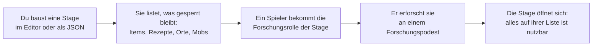

# History Stages {/* #history-stages */}

History Stages ist ein Framework für Fortschritt und Sperren in Modpacks. Du legst **Stages** an,
listest auf, was jede Stage zurückhält, und Spieler schalten sie frei, indem sie an einem
Forschungspodest forschen. Bis eine Stage offen ist, bleibt alles darin unerreichbar: Das Item lässt
sich nicht benutzen, das Rezept nicht herstellen, die Dimension nicht betreten, und der Mob spawnt
nicht.

Von Haus aus ist nichts gesperrt. Ein installiertes History Stages ohne Stage-Dateien ändert nichts
am Spiel.

:::note[Welche Version ist das?]
Diese Seiten beschreiben **6.2.x**, die Version für NeoForge 1.21.1, Forge 1.20.1 und Fabric 1.21.1.
Die 26.2-Beta ist noch auf **6.1.x**. Die wählst du, wie jede ältere Version, oben in der Leiste im
Versionsmenü aus. Details stehen unter [Versionen & Plattformen](/wiki/about/versions-and-platforms).
:::

## Wie alles zusammenhängt {/* #how-it-fits-together */}

Forschung ist der übliche Weg, aber nicht der einzige: Eine Stage kann sich auch von selbst öffnen,
wenn eine Bedingung erfüllt ist, oder per Befehl. → [Stage-Modi](/wiki/stage-file/stage-modes) ·
[Forschungspodest](/wiki/in-game-tools/research/pedestal) ·
[Forschungsrollen](/wiki/in-game-tools/research/scrolls)

## Zwei Arten von Stage {/* #two-kinds-of-stage */}

|  | Freigeschaltet von | Gilt für | Typischer Einsatz |
| :--- | :--- | :--- | :--- |
| **Global** | einem Spieler, einmal | den ganzen Server | Epochen: Steinzeit, Eisenzeit, Endgame |
| **Individuell** | jedem Spieler einzeln | nur diesen Spieler | eigene Skill-Pfade, Berufe |

Beide lassen sich im selben Modpack frei mischen, und ein paar Sperr-Arten funktionieren nur in einer
von beiden. Steht derselbe Inhalt in einer globalen *und* einer individuellen Stage, schaltet History
Stages dafür von selbst eine zweistufige **Dual-Phase-Sperre** ein.

→ [Globale vs. individuelle Stages](/wiki/start-here/global-vs-individual) solltest du lesen, bevor du
ein Modpack planst. Dort steht die komplette Übersicht, welche Sperre in welchem Modus funktioniert und
warum.

## Was eine Stage zurückhalten kann {/* #what-a-stage-can-hold-back */}

| | |
| :--- | :--- |
| [Items, Tags & Mods](/wiki/locking/items-and-recipes/items-tags-mods) | Einzelne Items, ganze Item-Tags oder jedes Item einer Mod-ID. |
| [NBT & Data Components](/wiki/locking/items-and-recipes/nbt-and-components) | Nur die verzauberten Bücher mit Schärfe, nur der rote Lederharnisch. |
| [Unlock Actions](/wiki/locking/items-and-recipes/unlock-actions) | Eine einzelne Interaktion sperren statt aller: tragen ja, zuschlagen nein. |
| [Rezepte](/wiki/locking/items-and-recipes/recipes) | Bestimmte Rezept-IDs, mit Schloss-Overlay in JEI und EMI. |
| [Flüssigkeiten](/wiki/locking/items-and-recipes/fluids) | Die Flüssigkeit, nicht der Eimer. Ein Eintrag deckt jeden Tank und Eimer im Modpack ab. |
| [Verzauberungen & Effekte](/wiki/locking/items-and-recipes/enchantments-and-effects) | Bücher, Ausrüstung und Tränke danach, was sie tragen, und die Stationen, die sie herstellen. |
| [Tarnungen](/wiki/locking/items-and-recipes/disguises) | Ein gesperrtes Item oder ein Block, der wie etwas anderes aussieht, bis die Stage offen ist. |
| [Loot](/wiki/locking/items-and-recipes/loot) | Gesperrte Items aus Truhen-Loot und Mob-Drops entfernen oder ersetzen. |
| [Slots](/wiki/locking/items-and-recipes/slots) | Inventar- und Behälter-Slots, die zu bleiben, bis die Stage offen ist. |
| [Dimensionen & Strukturen](/wiki/locking/world/dimensions-and-structures) | Den Zugang zu einer Dimension verweigern, eine Struktur abriegeln oder begrenzen, wie oft sie generiert. |
| [Biome](/wiki/locking/world/biomes) | Ein Biom unbewohnbar machen, bis die Stage offen ist. |
| [Pflanzen](/wiki/locking/world/plants) | Feldfrüchte und Setzlinge, die nicht wachsen, bis die Stage offen ist. |
| [Zonen](/wiki/locking/world/zones) | Selbst gezeichnete Bereiche, jeder mit eigenen Regeln. |
| [Kreaturen & Spawns](/wiki/locking/creatures-and-trade/entities-and-spawns) | Angriffe, Züchten und Reiten verhindern oder eine komplette Spawn-Regel schreiben. |
| [Händler-Angebote](/wiki/locking/creatures-and-trade/merchant-trades) | Ein einzelnes Angebot, einen ganzen Dorfbewohner-Beruf oder eine Händlerstufe überall sperren. |

→ [Was sich sperren lässt](/wiki/locking) hat dieselbe Liste nach Art sortiert, dazu, was du vor
der Wahl wissen solltest.

## Im Spiel bauen {/* #build-it-in-the-game */}

Der [Editor im Spiel](/wiki/in-game-tools/in-game-editor) ist der normale Weg, ein Modpack zu bauen,
und fast jedes Modpack entsteht komplett darin. Pausemenü, Berechtigungsstufe 2 oder
`/history editor`.

Eine Stage öffnet sich mit einem Reiter für alles, was sie sperren kann, dazu durchsuchbare Auswahllisten,
die die echte Registry lesen, ein visueller NBT-Editor, ein Zonen-Editor mit Karte und ein Editor für
Abhängigkeiten. Eine ID, die es nicht gibt, kannst du gar nicht eintragen, und Speichern lädt sofort
neu.

**Darunter liegen einfache JSON-Dateien**, eine pro Stage, unter `config/historystages/`. Sie lassen
sich von Hand lesen und bearbeiten, und der Editor schreibt dasselbe Format, also kannst du beides
mischen. Dieses Wiki beschreibt Stages über ihre Felder statt über die Knöpfe, weil sich ein Feld
leichter benennen lässt. Jede Seite sagt dazu, wo du dasselbe im Editor findest.

→ [Installation & deine erste Stage](/wiki/start-here/installation) ·
[Wo die Stage-Dateien liegen](/wiki/start-here/where-stage-files-live) ·
[Aufbau einer Stage-Datei](/wiki/stage-file/anatomy)

Du richtest zum ersten Mal einen Multiplayer-Server ein? →
[Auf einen Server bringen](/wiki/start-here/server-setup) führt Schritt für Schritt durch. Etwas
verhält sich komisch? → [Fehlersuche](/wiki/start-here/troubleshooting)

## Spielern zeigen, wo sie stehen {/* #showing-players-where-they-are */}

Große Modpacks können im Pausemenü einen interaktiven [Stufen-Graph](/wiki/in-game-tools/stage-graph)
öffnen lassen. Er zeigt den ganzen Fortschrittsbaum und wo der Spieler darin gerade steht.

Skripte lesen und ändern Stages über [KubeJS und CraftTweaker](/wiki/server/scripting), und andere Mods
erweitern History Stages über die [Addon-API](/api/addon-development).
